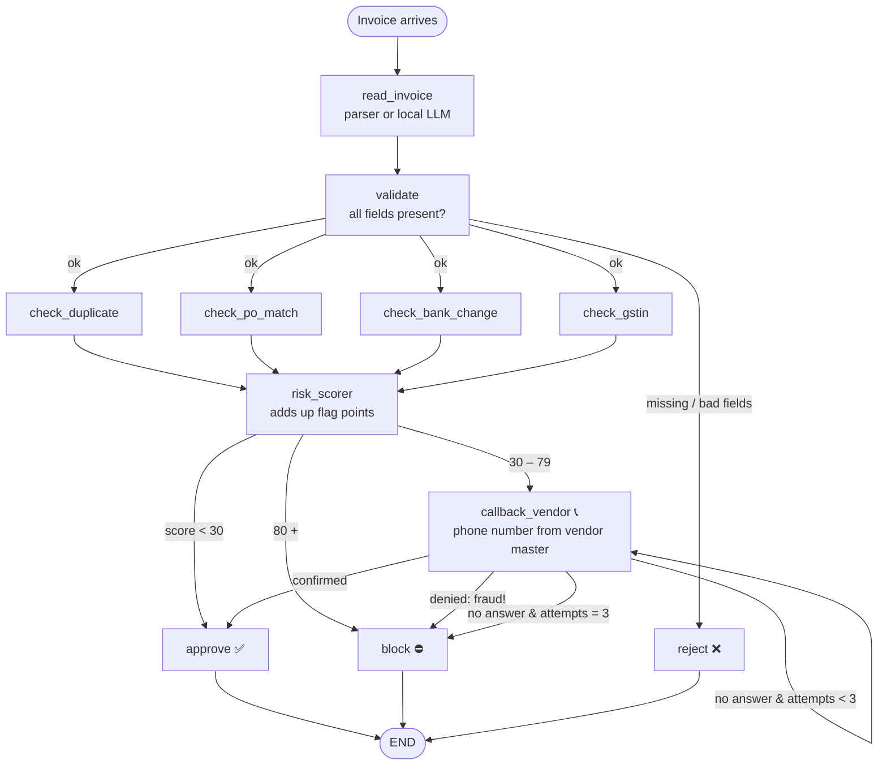

# Vendor Payment Guard: Project Plan

> A local AI agent that checks every vendor invoice **before money leaves the company**,
> and stops fake invoices and bank-detail fraud.
> Built as a deterministic state machine with LangGraph.

This file is the blueprint. No code yet. Read it top to bottom once, then we build it step by step.

---

## 1. The problem (in one story)

A small Pune manufacturer gets an email from their regular steel supplier:
*"We have changed our bank. Please pay invoice #4521 to this new account."*
The email looks real. It even has the right PO number. Accounts pays ₹2.35 crore.
The supplier never sent it. A fraudster had hacked or copied their email.

This is called **vendor / invoice fraud** (Business Email Compromise). Real Indian cases:
₹2 crore (Chennai), ₹2.35 crore (Pune). Small and mid-size companies are hit hardest
because their accounts team checks invoices **by hand, under time pressure**.

**Our product:** a security checkpoint. Every invoice passes through a set of guards.
Safe ones are approved. Suspicious ones need a phone call to the real vendor. Dangerous ones are blocked.

---

## 2. Is there any "training"? (No.)

| Question | Answer |
|---|---|
| Do we train a model? | **No.** There is no machine-learning training in this project. |
| Where does the "intelligence" come from? | From the **orchestration**: the state machine decides which check runs, in what order, and what happens next. The rules are written by us, like a company's finance policy. |
| Is there an LLM at all? | Optional, for **one job only**: reading a messy invoice text and pulling out the fields. We use a **pre-trained** local model (`qwen3:4b-instruct` via Ollama, already on your laptop). We don't train it; we just use it. |
| Why not let the LLM decide approve/block? | Money decisions must be **deterministic and auditable**. An LLM can give different answers on different runs. **"The LLM reads, the rules decide."** That one line is a strong viva answer. |
| What data do we use? | **Synthetic (mock) data we write ourselves**: 5 vendors, their purchase orders, goods receipts, past payments, and 7 test invoices. All of it lives inside the notebook, so it runs offline. |

---

## 3. The data we will create (mock company: "Shakti Auto Components, Pune")

| Table | What it holds | Example |
|---|---|---|
| **Vendor master** | Trusted record of each vendor: name, GSTIN, bank account, **phone on file** | `V001, Sharma Steel, 27AABCS1234F1Z5, A/c 50100234567, +91-98xxxxxx01` |
| **Purchase orders (PO)** | What we ordered and the agreed amount | `PO-1001, V001, ₹4,50,000` |
| **Goods receipts (GRN)** | Proof the goods actually arrived | `GRN-1001 for PO-1001, received` |
| **Paid invoices** | History of invoices already paid (to catch duplicates) | `V001 / INV-4410 / paid` |
| **Incoming invoices** | The 7 test invoices the agent will check (see section 9) | text like an email body |
| **Callback script** | What happens when the agent "phones" a vendor (simulated) | `V004 → "denied"` |

**Key anti-fraud idea:** when verifying, the agent calls the phone number **from the vendor master**,
never the number printed on the invoice. The fraudster controls the invoice, not our master data.

---

## 4. How invoices are read

```
Raw invoice text (like an email body)
            │
     [read_invoice] node
            │
   ┌────────┴─────────┐
 USE_LLM = True     USE_LLM = False
 Local LLM          Simple Python parser
 (Ollama, qwen3)    (splits "Field: value" lines)
   └────────┬─────────┘
            ▼
 Clean invoice dict: {invoice_no, vendor_id, po_number, amount, gstin, bank_account}
```

- **Midterm version:** invoices are plain text in a fixed template. The simple parser always works.
  The LLM path shows real "function calling" and handles messy text.
- **If the LLM gets a field wrong**, the next node (`validate`) catches missing or invalid fields and rejects the invoice.
  We treat LLM output as **untrusted input**. That's another good viva point.
- **Product version (later):** read PDFs (`pdfplumber`), watch an email inbox, import from Tally.

---

## 5. Tools (function calling)

Tools are small Python functions the agent calls to **look things up**. Each does one thing.

| Tool | Called by node | Returns |
|---|---|---|
| `find_vendor(name)` | `validate` | vendor master record or `None` (unknown vendor → reject) |
| `find_purchase_order(po_number)` | `check_po_match` | PO record or `None` |
| `find_goods_receipt(po_number)` | `check_po_match` | GRN number or `None` |
| `is_already_paid(vendor_id, invoice_no)` | `check_duplicate` | `True/False` |
| `is_valid_gstin_format(gstin)` | `check_gstin` | `True/False` (15-char Indian GSTIN pattern) |
| `call_vendor(phone, attempt)` | `callback_vendor` | `"confirmed"`, `"denied"` or `"no_answer"` (simulated, scripted per attempt) |
| `extract_invoice_fields(...)` | `read_invoice` (LLM path) | the schema the LLM fills in via **tool calling** |

So "function calling" happens at two levels:
1. **Nodes call tools** (plain Python, deterministic).
2. **The LLM calls a tool** to return structured invoice fields (optional LLM path).

---

## 6. The state (the agent's memory)

The **state** is one dictionary that travels through the graph. Each node reads it and returns
**only the part it changed**. That partial update is the **delta**.

| Field | Type | Reducer? | Why |
|---|---|---|---|
| `raw_text` | str | no (overwrite) | the incoming invoice text |
| `invoice` | dict | no | parsed fields |
| `risk_flags` | list[str] | **YES, `operator.add`** | 4 checks run **in parallel** and all add flags. Without a reducer, LangGraph raises an error because it can't merge 4 writes to one key. |
| `audit_log` | list[str] | **YES, `operator.add`** | every node appends one line, giving a full trail of what happened |
| `risk_score` | int | no | computed once by the scorer |
| `call_attempts` | int | no | the **loop counter** that prevents infinite calling |
| `vendor_response` | str | no | the last callback result |
| `decision` | str | no | `APPROVED` / `BLOCKED` / `REJECTED` |

**Reducer in one sentence:** a reducer is the rule for *combining* a node's delta with the existing value.
No reducer means the new value replaces the old one. `operator.add` means the new list is appended to the old one.

---

## 7. The graph (the whole flow)



**Nodes (9), one job each:**

| Node | Job |
|---|---|
| `read_invoice` | turn raw text into an invoice dict |
| `validate` | check required fields exist; route to `reject` or fan out to the 4 checks |
| `check_duplicate` | was this invoice already paid? |
| `check_po_match` | does a PO exist? is the amount within the PO? did goods arrive? |
| `check_bank_change` | does the invoice bank account match the vendor master? |
| `check_gstin` | valid format? matches the vendor master? |
| `risk_scorer` | add up flag points and pick the route |
| `callback_vendor` | "phone" the vendor; the **loop** lives here |
| `approve` / `block` / `reject` | set the final decision and write to the audit log |

---

## 8. Risk rules (our "finance policy")

| Flag | Points | Raised by |
|---|---|---|
| `DUPLICATE_INVOICE` | 100 | check_duplicate |
| `BANK_DETAILS_CHANGED` | 50 | check_bank_change |
| `NO_MATCHING_PO` | 40 | check_po_match |
| `AMOUNT_EXCEEDS_PO` | 30 | check_po_match |
| `GOODS_NOT_RECEIVED` | 30 | check_po_match |
| `INVALID_GSTIN` | 40 | check_gstin |
| `GSTIN_MISMATCH` | 40 | check_gstin |

| Total score | Route |
|---|---|
| 0 – 29 | **approve** |
| 30 – 79 | **callback_vendor** (human-style verification) |
| 80 + | **block** |

These are plain constants at the top of the notebook, so they're easy to change in the viva
("What if the bank-change score were 90?" Change one number, re-run, and show the new path).

---

## 9. The loop, and how we stop it running forever

**The loop:** `callback_vendor → callback_vendor → …`
The vendor might not pick up, so we try again. That's a cycle in the graph.

**The danger:** if the vendor *never* answers and nothing counts attempts, the graph loops forever.

**Our two guards:**
1. **Business guard (in state):** `call_attempts` goes up by 1 on every call. The router checks
   `call_attempts >= MAX_CALLS (3)` and sends the invoice to `block` (unverified = unsafe).
2. **Safety net (in LangGraph):** `recursion_limit` in the run config. If a bug ever removes guard #1,
   LangGraph stops the run with a `GraphRecursionError` instead of hanging.

**Tutorial demo:** we deliberately remove guard #1, run it, catch the `GraphRecursionError`, and explain it.
That shows we understand infinite loops, not just avoid them.

---

## 10. Test scenarios (also our edge cases and demo script)

| # | Invoice | What's special | Expected path | Final |
|---|---|---|---|---|
| 1 | Sharma Steel, clean | everything matches | checks → score 0 → approve | ✅ APPROVED |
| 2 | Sharma Steel, resubmitted | already paid | DUPLICATE → score 100 → block | ⛔ BLOCKED |
| 3 | Patil Plastics | new bank account, no answer on call 1, confirms on call 2 | score 50 → call ✗ → call ✅ (**loop that ends naturally**) → approve | ✅ APPROVED (verified) |
| 4 | Gupta Bearings | new bank account, vendor says *"we never changed it"* | score 50 → call ❌ → block | ⛔ BLOCKED, **fraud caught** |
| 5 | Rao Rubber | new bank account, vendor never answers | score 50 → call ×3 (**loop**) → block | ⛔ BLOCKED (unverified) |
| 6 | Unknown sender | invalid GSTIN + bank change | score 90 → block | ⛔ BLOCKED |
| 7 | Broken invoice | PO number / amount missing | validate → reject | ❌ REJECTED |

Bonus edge case for the viva: amount is ₹10,000 above the PO → `AMOUNT_EXCEEDS_PO` (30) → callback.

---

## 11. Visual traceability (rubric item 1)

All generated **by code, fully offline**:

1. **Architecture picture:** `graph.get_graph().draw_ascii()` prints the graph structure in the notebook
   (needs no internet). We avoid `draw_mermaid_png()` because by default it calls an online service,
   which would break the "completely local" rule.
2. **Behaviour picture per invoice:** a small `matplotlib` + `networkx` drawing of the graph with
   the **path this invoice took highlighted** (green = approved path, red = blocked path).
   Seven invoices give seven different highlighted paths, which shows the agent's behaviour visually.
3. **Delta trace table:** for each invoice, a table of `step | node | delta returned`, built from
   `graph.stream(..., stream_mode="updates")`. This is "tracing the delta".
4. **Summary dashboard:** one table of all 7 invoices: flags, score, calls made, decision.

---

## 12. Repo structure and LMS submission

```
Vendor_Payment_Guard/
├── README.md                    ← product overview, flow diagrams, how to run
├── PLAN.md                      ← this file
├── vendor_payment_guard.ipynb   ← LMS FILE 1: the full agent (self-contained, data inside)
├── TUTORIAL.md                  ← beginner tutorial (exported to PDF)
├── TUTORIAL.pdf                 ← LMS FILE 2
├── requirements.txt
├── assets/                      ← diagrams/screenshots used by README and TUTORIAL
└── videos/
    └── SCRIPTS.md               ← scripts for the tutorial videos
```

**LMS rule = max 2 files** → `vendor_payment_guard.ipynb` + `TUTORIAL.pdf`.
That's why the mock data lives **inside** the notebook: one file runs on its own.

---

## 13. The tutorial (TUTORIAL.md → PDF), written for a beginner

1. The problem: the ₹2 crore email
2. Stateless chatbot vs stateful agent: why we need a state machine
3. Architecture at a glance (diagram)
4. **State and the reducer pattern** (diagram of 4 parallel deltas merging into `risk_flags`, plus what breaks without it)
5. Nodes and tools (function calling)
6. Conditional routing (the 3-way decision)
7. **Loops and infinite loops** (the callback cycle, counter, `recursion_limit`, the deliberately broken demo)
8. **Tracing the delta**: invoice #5 walked through step by step, state before and after each node
9. **Agent behaviour diagrams**: the 7 highlighted paths
10. Edge cases and how each is handled
11. Try it yourself (3 small exercises)
12. Glossary

---

## 14. Tutorial videos (optional, recorded by you)

Five short videos (3–6 min each), one per build step. Scripts go in `videos/SCRIPTS.md`.

| Video | Topic | Shows |
|---|---|---|
| 1 | The problem + live demo | run all 7 invoices, show results |
| 2 | State and reducers | the `risk_flags` merge, the error without a reducer |
| 3 | Nodes, tools, routing | one check node + the scorer's routing |
| 4 | Loops | invoice #5 calling 3 times; the broken infinite-loop demo |
| 5 | Delta tracing | step-by-step state changes for one invoice |

Recording: OBS Studio or the Windows screen recorder (Win + Alt + R), with VS Code/Jupyter on screen.

---

## 15. Build order (one git commit per step)

We build in small layers. **This is also how you rebuild it from memory in the viva.**

| Step | What we add | You can now explain… |
|---|---|---|
| 0 ✅ | Environment: `.venv`, install `langgraph`, `ipykernel`, `matplotlib`, `networkx`, `grandalf`, `ollama`, `pandas` | setup |
| 1 ✅ | Settings + mock data + 7 test invoices + tools (plain Python, no LangGraph yet) | the business problem and data |
| 2 | State + `read_invoice` → `validate` → `END` (a straight line) | what state and nodes are |
| 3 | 4 check nodes in parallel + `risk_flags` reducer + scorer | **the reducer pattern** |
| 4 | Conditional routing: approve / callback / block / reject | routing |
| 5 | Callback loop + `call_attempts` guard + `recursion_limit` | **loops and infinite loops** |
| 6 | Visuals: ASCII graph, highlighted paths, delta trace table, summary | **visual traceability, delta tracing** |
| 7 | Optional: local LLM reader with tool calling (`USE_LLM` switch) | function calling with an LLM |
| 8 | README with diagrams + TUTORIAL.md + PDF export | architecture write-up |
| 9 | Video scripts + viva rehearsal questions | defense |

**Code-simplicity rules we'll follow:**
- One notebook, top to bottom, no classes, no frameworks beyond LangGraph.
- Every node is a small function, typically 5–15 lines, with a one-line comment saying its job.
- Plain names (`check_bank_change`, not `BankVerificationStrategyHandler`).
- No hidden magic: rules and thresholds are constants at the top.

---

## 16. Likely viva questions (we'll prepare answers in step 9)

1. Why do you need a reducer on `risk_flags`? What happens without one?
2. What stops the callback loop from running forever? Show me.
3. Trace the delta for invoice #5.
4. Why doesn't the LLM make the approve/block decision?
5. Why do you call the phone number from the vendor master and not the one on the invoice?
6. Add a new check live (e.g. "invoice amount above ₹10 lakh needs a callback").
7. Change a threshold and show how the path changes.
8. What's the difference between state, delta and reducer?

---

## 17. After the midterm: the product roadmap

1. Read real PDF invoices and email inboxes.
2. Store vendor master / PO / GRN in SQLite, then connect to Tally / Zoho Books.
3. Real callback: a WhatsApp/SMS OTP to the vendor's registered number, with human approval for high values.
4. Human-in-the-loop approvals with LangGraph `interrupt` and checkpointing.
5. Dashboard for the accounts team; monthly fraud report.
6. Modules: payment recovery, GST credit recovery and loan readiness, forming the MSME finance suite.

---

## Open decisions

- [x] Include the optional local-LLM invoice reader (step 7)? **Yes**, behind a `USE_LLM` switch, so the demo still works if Ollama is off.
- [ ] Midterm deadline / viva date, which decides how much of steps 7–9 we do.
