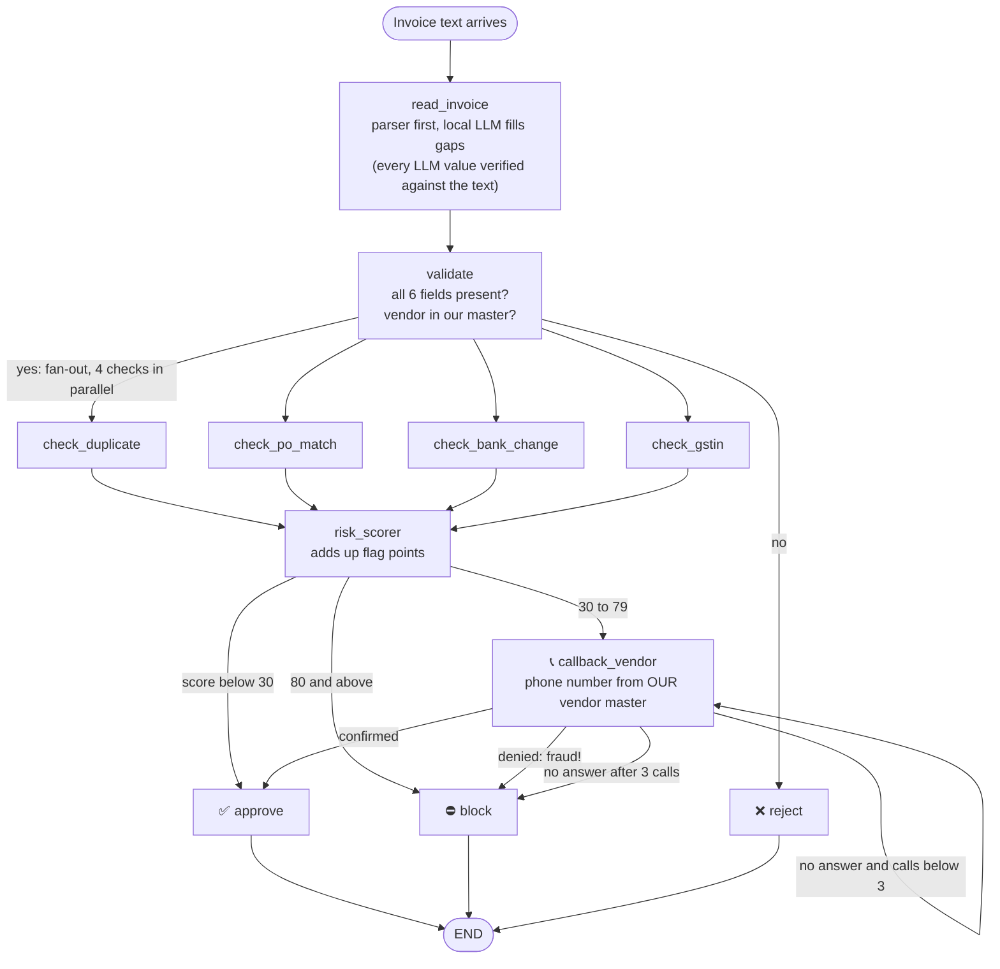
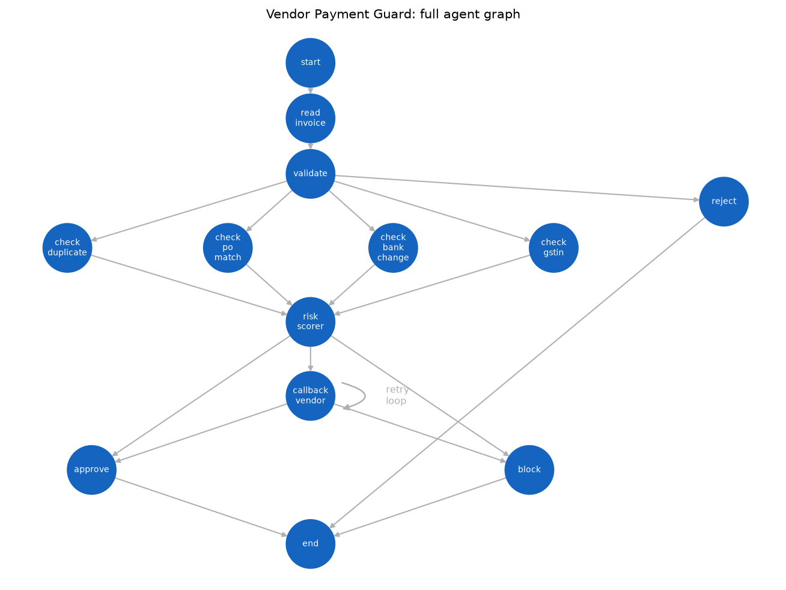
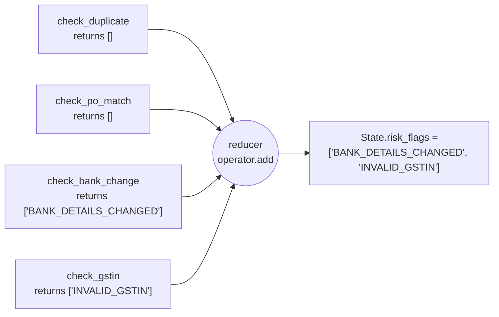
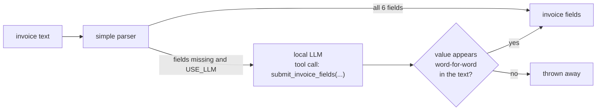
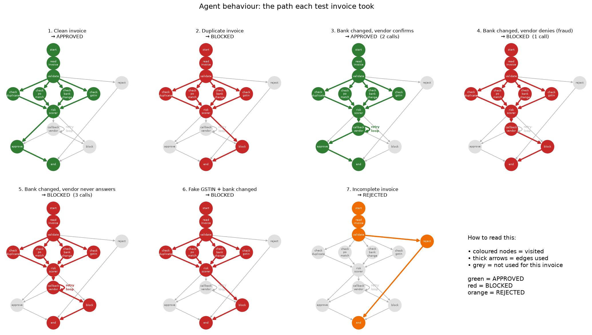

# 🛡️ Vendor Payment Guard

**A local AI agent that checks every vendor invoice *before* money leaves the company,
and stops fake invoices and bank-detail fraud.**

Built as a deterministic **state machine** with [LangGraph](https://github.com/langchain-ai/langgraph).
Runs **100% on your own laptop**: plain Python rules, plus an optional local LLM ([Ollama](https://ollama.com), `qwen3:4b-instruct`) for reading messy invoices.

> Midterm project · Agentic AI (STAI343) · Vijaybhoomi University

---

## The problem

A supplier's email gets hacked or copied. The fraudster sends a perfectly normal-looking invoice,
with the right PO number and the right amount, but with **one change: the bank account is theirs**.
The accounts team, busy at month-end, pays it.

This is **vendor / invoice fraud** (Business Email Compromise). Indian companies have lost
**₹2 crore (Chennai)** and **₹2.35 crore (Pune)** this way. Small and mid-size companies are hit hardest,
because invoices are checked by hand, under time pressure.

## The solution

Vendor Payment Guard is a **security checkpoint for payments**. Every invoice passes through a set of guards:

| Result | When |
|---|---|
| ✅ **APPROVE** | everything matches the company's own records |
| 📞 **CALL THE VENDOR** | something is suspicious, so phone the vendor on the number **we** have on file (never the one on the invoice) |
| ⛔ **BLOCK** | clearly dangerous, the vendor denies sending it, or the vendor can't be reached |
| ❌ **REJECT** | the invoice is incomplete or from an unknown vendor |

**Golden rule: *the LLM reads, the rules decide.*** The local LLM may help *read* a messy invoice,
but every approve/block decision is made by fixed, auditable rules.

---

## How it works: the full flow



The same graph, **drawn by the code itself** (`matplotlib` + `networkx`, from `graph.get_graph()`):



### What each node does

| # | Node | Job | Tools it calls |
|---|---|---|---|
| 1 | `read_invoice` | turn invoice text into 6 fields (parser → local LLM for gaps → verify) | `ask_llm_to_read` → LLM calls `submit_invoice_fields` |
| 2 | `validate` | can this invoice be checked at all? | `find_vendor` |
| 3 | `check_duplicate` | already paid? | `is_already_paid` |
| 4 | `check_po_match` | real PO? amount within PO? goods received? | `find_purchase_order`, `find_goods_receipt` |
| 5 | `check_bank_change` | bank account same as **our** records? | – |
| 6 | `check_gstin` | valid GSTIN format? this vendor's GSTIN? | `is_valid_gstin_format` |
| 7 | `risk_scorer` | add up the points of all flags | – |
| 8 | `callback_vendor` | phone the vendor (simulated), count the call | `call_vendor` |
| 9–11 | `approve` / `block` / `reject` | write the final decision and the reason | – |

### The finance policy (risk rules)

| Flag | Points | | Total score | Route |
|---|---|---|---|---|
| `DUPLICATE_INVOICE` | 100 | | 0 – 29 | approve |
| `BANK_DETAILS_CHANGED` | 50 | | 30 – 79 | call the vendor |
| `NO_MATCHING_PO` | 40 | | 80 + | block |
| `INVALID_GSTIN` | 40 | | | |
| `GSTIN_MISMATCH` | 40 | | | |
| `AMOUNT_EXCEEDS_PO` | 30 | | | |
| `GOODS_NOT_RECEIVED` | 30 | | | |

All of these are constants at the top of the notebook: change a number, re-run, and watch the paths change.

---

## The three core ideas

### 1. State, delta and reducer

One dictionary, the **State**, travels through the graph like a file folder moving from desk to desk.
Each node returns **only what it changed**, the **delta**. A **reducer** decides how that delta is merged in.

| State field | Reducer | Why |
|---|---|---|
| `raw_text`, `invoice`, `vendor`, `errors` | replace | written once |
| **`risk_flags`** | **`operator.add` (append)** | **4 checks write it in the same step** |
| `risk_score`, `call_attempts`, `vendor_response` | replace | the loop overwrites `call_attempts` each round |
| `decision`, `reason` | replace | written once at the end |
| **`audit_log`** | **`operator.add` (append)** | every node adds one line, giving a full trail |



**Without the reducer**, LangGraph can't choose between four values for one key and stops with
`InvalidUpdateError: At key 'risk_flags': Can receive only one value per step.` The notebook proves this in Section 9.

### 2. The loop, and how infinite loops are prevented


| Guard | Where | Role |
|---|---|---|
| **#1 `MAX_CALLS = 3`** | `route_after_call` checks `call_attempts < MAX_CALLS` | business rule: the *intended* exit |
| **#2 `recursion_limit = 20`** | `config=RUN_CONFIG` on every run | safety net: LangGraph raises `GraphRecursionError` if a bug causes a runaway loop |

The notebook deliberately removes guard #1 (Section 10) and shows guard #2 stopping the runaway loop.

### 3. The LLM reads, the rules decide



When tested, the 4B local model read messy emails well, but sometimes **copied values wrongly**
(`PO-1001` → `PO-10_001`, one digit changed in a bank account). So it only fills gaps, and nothing it says is
accepted unless it appears in the source text. If Ollama isn't running, the agent falls back to the parser.

---

## Results on the 7 test invoices

Every invoice takes a different path. Green = approved, red = blocked, orange = rejected.



| # | Invoice | What's special | Score | Calls | Decision |
|---|---|---|---|---|---|
| 1 | Sharma Steel | clean | 0 | 0 | ✅ APPROVED |
| 2 | Sharma Steel | already paid (duplicate) | 100 | 0 | ⛔ BLOCKED |
| 3 | Patil Plastics | new bank account, vendor confirms on the 2nd call | 50 | 2 | ✅ APPROVED |
| 4 | Gupta Bearings | new bank account, vendor says *"we never sent this"* | 50 | 1 | ⛔ BLOCKED: **fraud caught** |
| 5 | Rao Rubber Works | new bank account, vendor never answers | 50 | 3 | ⛔ BLOCKED (unverified) |
| 6 | "Mehta Packaging" | fake GSTIN + new bank account | 90 | 0 | ⛔ BLOCKED |
| 7 | Mehta Packaging | PO number and amount missing | – | 0 | ❌ REJECTED |
| bonus | messy email from Sharma Steel | not in template format | 0 | 0 | ❌ with parser only, ✅ with local LLM |

---

## Run it yourself

**Requirements:** Python 3.11+, and optionally [Ollama](https://ollama.com) for the LLM reader.

```bash
git clone https://github.com/PreeyasTumulu/Vendor_Payment_Guard.git
cd Vendor_Payment_Guard
python -m venv .venv
.venv\Scripts\activate          # Windows   (macOS/Linux: source .venv/bin/activate)
pip install -r requirements.txt
ollama pull qwen3:4b-instruct   # optional: the local LLM reader
```

Open `vendor_payment_guard.ipynb` in VS Code or Jupyter, pick the **`.venv`** kernel, and **Run All**.
No API keys and no internet are needed at run time. Without Ollama, set `USE_LLM = False` (or leave it on: the agent falls back to the parser automatically).

---

## Repository

| File | What it is |
|---|---|
| `vendor_payment_guard.ipynb` | the whole agent: settings, mock data, tools, state, nodes, graph, runs, visuals, LLM demo (self-contained) |
| `TUTORIAL.md` / `TUTORIAL.pdf` | beginner tutorial: reducers, loops, delta tracing, diagrams |
| `PLAN.md` | the project blueprint and build log |
| `assets/` | diagrams generated by the notebook |
| `scripts/make_tutorial_pdf.py` | rebuilds `TUTORIAL.pdf` from `TUTORIAL.md` (pandoc + Edge) |

## Honest limitations (and the roadmap)

| Today (midterm) | Next (product) |
|---|---|
| mock data in Python dictionaries | SQLite, then connectors for Tally / Zoho Books |
| phone calls are simulated by a script | WhatsApp/SMS OTP to the vendor's registered number |
| invoices are text | PDF invoices (`pdfplumber`) and an email inbox watcher |
| no human approval step | LangGraph `interrupt` + checkpointing for finance-head approval of high-value payments |
| a confirmed bank change doesn't update the vendor master | controlled vendor-master change workflow |
| no detection of invoices split to stay under limits | rolling per-vendor totals |

Later modules for an MSME finance suite: payment recovery (overdue invoices), GST credit recovery, loan readiness.
