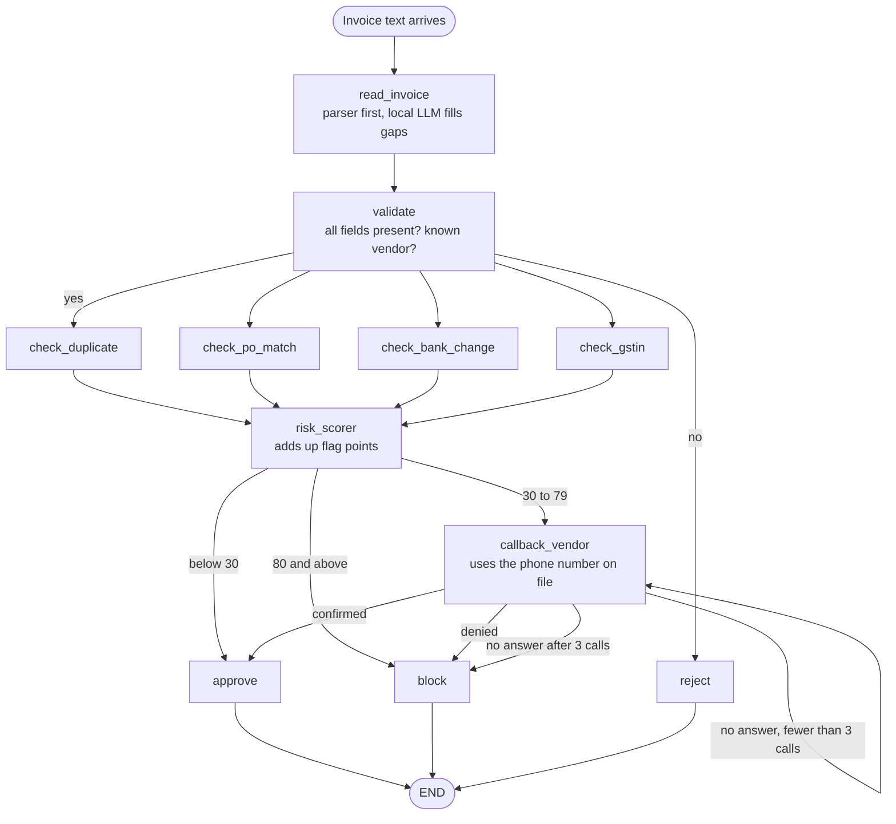
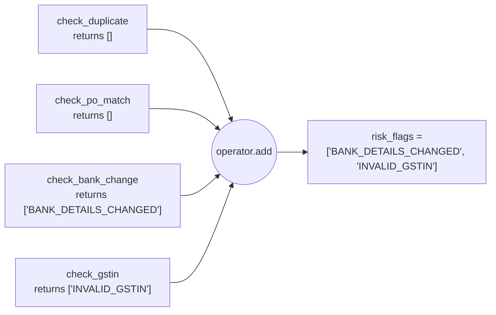
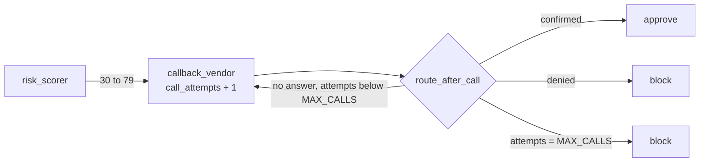
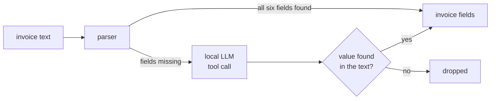

# Vendor Payment Guard

A LangGraph agent that checks vendor invoices before they get paid, so that fake invoices and changed bank details
get caught before the money goes out. It runs entirely on your own machine: the decisions come from plain Python rules,
and a local LLM ([Ollama](https://ollama.com), `qwen3:4b-instruct`) is only used to help read invoices that aren't in
the standard format.

Midterm project for Agentic AI (STAI343), Vijaybhoomi University.

## The problem

Invoice fraud usually starts with a supplier's email account. Someone hacks it, or sets up a lookalike, and sends an
invoice that looks completely normal: the right PO number, the right amount, the usual format. The one difference is
the bank account, which now belongs to them. If the accounts team is busy, it gets paid.

This is known as business email compromise, and it has cost Indian companies ₹2 crore (Chennai) and ₹2.35 crore
(Pune) in reported cases. Small and mid-size companies are the easiest targets because their invoices are usually
checked by hand.

## What the agent does

Every invoice goes through a few checks against the company's own records, and each problem adds points to a risk
score. Then:

- a low score (under 30) is approved;
- a high score (80 or more) is blocked;
- anything in between gets a phone call to the vendor, using the number we already have on file rather than anything
  printed on the invoice. If the vendor confirms, the invoice is approved. If they deny sending it, or can't be
  reached after three tries, it's blocked.

Invoices with missing fields, or from vendors we don't know, are rejected before any checks run.



The notebook draws the same graph from the compiled LangGraph object:


### Nodes

| Node | What it does | Tools it uses |
|---|---|---|
| `read_invoice` | pulls six fields out of the invoice text | parser, then `ask_llm_to_read` for anything missing |
| `validate` | checks the fields are there and the vendor exists | `find_vendor` |
| `check_duplicate` | has this invoice been paid already? | `is_already_paid` |
| `check_po_match` | is there a matching PO, is the amount within it, did the goods arrive? | `find_purchase_order`, `find_goods_receipt` |
| `check_bank_change` | does the bank account match our records? | |
| `check_gstin` | is the GSTIN valid, and is it this vendor's? | `is_valid_gstin_format` |
| `risk_scorer` | adds up the points for all flags | |
| `callback_vendor` | phones the vendor (simulated) and counts the call | `call_vendor` |
| `approve`, `block`, `reject` | record the decision and the reason | |

### Risk points

| Flag | Points |
|---|---|
| `DUPLICATE_INVOICE` | 100 |
| `BANK_DETAILS_CHANGED` | 50 |
| `NO_MATCHING_PO`, `INVALID_GSTIN`, `GSTIN_MISMATCH` | 40 each |
| `AMOUNT_EXCEEDS_PO`, `GOODS_NOT_RECEIVED` | 30 each |

These and the thresholds are constants at the top of the notebook, so it's easy to change one and see how the routes change.

## How it's built

### State and reducers

The state is a single dictionary passed from node to node. Each node returns only the keys it changed, and LangGraph
merges that delta into the state. Most keys are simply replaced. Two are declared with `operator.add`, so new values
get appended instead:

- `risk_flags`, because the four checks run in parallel and all write to it in the same step;
- `audit_log`, so each node can add a line without overwriting the others.



Without the reducer, LangGraph stops with `InvalidUpdateError: At key 'risk_flags': Can receive only one value per step`.
Section 9 of the notebook reproduces this on purpose.

### The retry loop

`callback_vendor` can route back to itself when the vendor doesn't pick up, which gives the graph a cycle. Two things
keep it from running forever:

1. `route_after_call` only loops while `call_attempts < MAX_CALLS` (3). This is the normal exit.
2. Every run passes `recursion_limit: 20`. If a bug ever removed the first check, LangGraph would raise
   `GraphRecursionError` instead of hanging. A normal run needs at most 8 steps.



Section 10 of the notebook removes the first check and shows the recursion limit stopping the runaway loop.

### Using the LLM for reading only

The parser reads our standard invoices. When it can't find a field, the local model is asked to read the text through
tool calling: it gets a `submit_invoice_fields` function and replies with the arguments it wants to call it with.

During testing the model sometimes copied values incorrectly (`PO-1001` came back as `PO-10_001`, and once a bank
account had a digit changed), so any value it returns is kept only if it appears word for word in the invoice text. If
Ollama isn't running, the agent uses the parser result alone. The LLM never makes the approve or block decision.



## Results

Each of the seven test invoices takes a different route through the graph (green approved, red blocked, orange rejected):


| # | Invoice | Situation | Score | Calls | Decision |
|---|---|---|---|---|---|
| 1 | Sharma Steel | everything matches | 0 | 0 | approved |
| 2 | Sharma Steel | already paid | 100 | 0 | blocked |
| 3 | Patil Plastics | new bank account, vendor confirms on the second call | 50 | 2 | approved |
| 4 | Gupta Bearings | new bank account, vendor says they never sent it | 50 | 1 | blocked (fraud) |
| 5 | Rao Rubber Works | new bank account, vendor never answers | 50 | 3 | blocked |
| 6 | Mehta Packaging | invalid GSTIN and new bank account | 90 | 0 | blocked |
| 7 | Mehta Packaging | PO number and amount missing | | 0 | rejected |

A messy invoice written as an email is rejected when only the parser is used, and approved once the LLM helps read it.

## Running it

You need Python 3.11 or newer. Ollama is optional.

```bash
git clone https://github.com/PreeyasTumulu/Vendor_Payment_Guard.git
cd Vendor_Payment_Guard
python -m venv .venv
.venv\Scripts\activate          # on macOS/Linux: source .venv/bin/activate
pip install -r requirements.txt
ollama pull qwen3:4b-instruct   # optional, for the LLM reader
```

Open `vendor_payment_guard.ipynb` in VS Code or Jupyter, select the `.venv` kernel and run all cells. No API keys or
internet connection are needed. Without Ollama the agent falls back to the parser on its own, or you can set
`USE_LLM = False`.

## Files

| File | Contents |
|---|---|
| `vendor_payment_guard.ipynb` | the agent, test data, experiments and visuals in one notebook |
| `TUTORIAL.md`, `TUTORIAL.pdf` | a step-by-step tutorial for beginners covering reducers, loops and delta tracing |
| `ACCOUNTS_TEAM_GUIDE.md`, `ACCOUNTS_TEAM_GUIDE.pdf` | a plain-language guide for the accounts team: what the tool checks, what each result means and what to do |
| `PLAN.md` | the original project plan and build log |
| `assets/` | diagrams generated by the notebook |
| `scripts/make_tutorial_pdf.py` | rebuilds the PDFs from the Markdown files using pandoc and Edge |

## Limitations

This is a midterm prototype, so a few things are simplified:

- vendor, PO and payment data live in Python dictionaries rather than an accounting system such as Tally or Zoho Books;
- the phone calls are simulated from a fixed script;
- invoices are plain text, not PDFs or emails pulled from an inbox;
- there's no human approval step for large payments (LangGraph's `interrupt` and checkpointing would fit here);
- a vendor confirming a new bank account doesn't update the vendor records yet;
- an invoice split into smaller ones to stay under a limit wouldn't be noticed.
