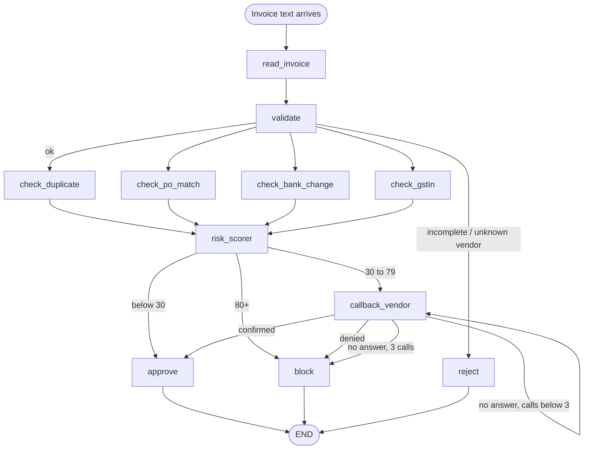
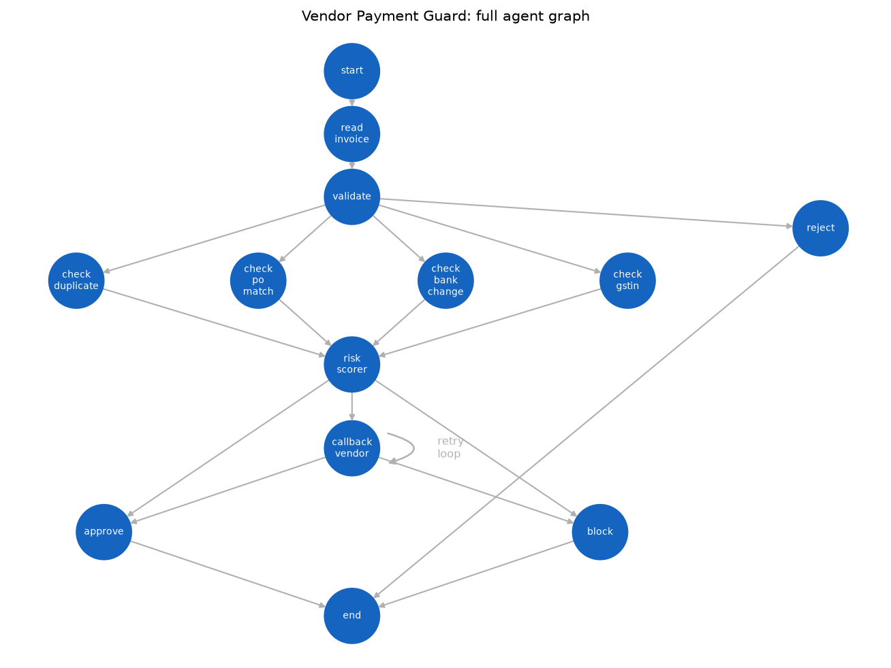
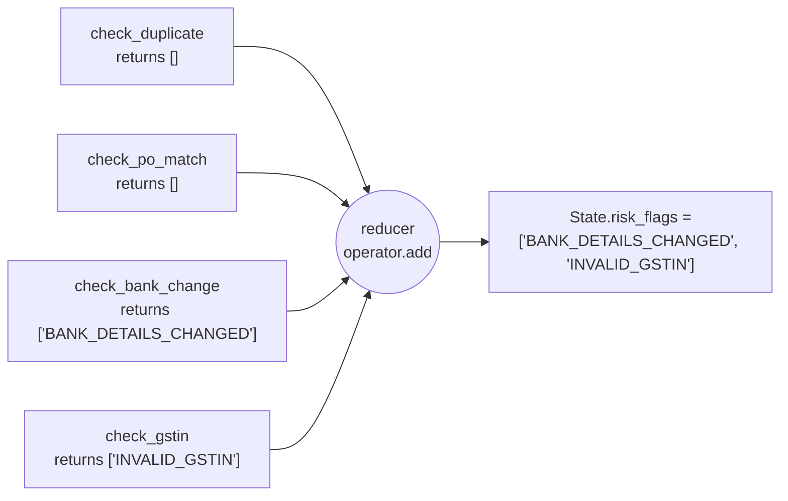
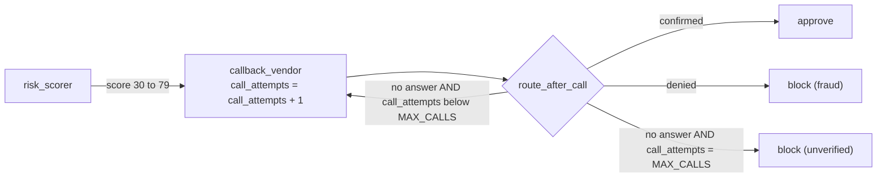
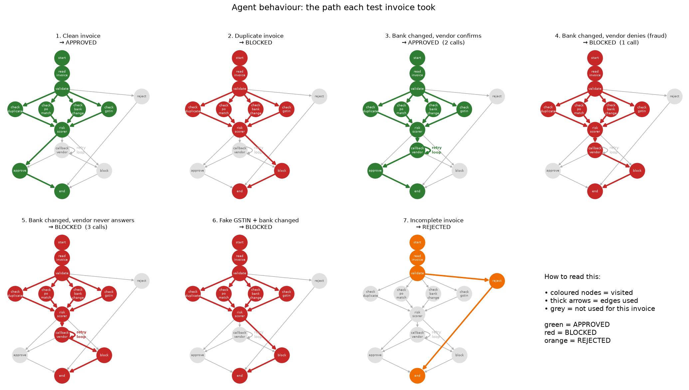
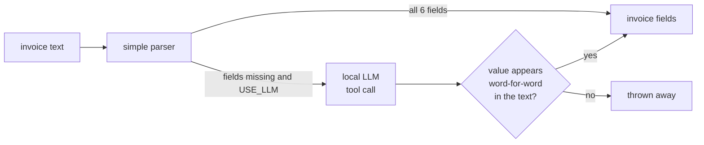

# Building a Stateful AI Agent with LangGraph

### A beginner's tutorial: *Vendor Payment Guard*, a local agent that stops invoice fraud

**Course:** Agentic AI (STAI343) · Mid-term project
**Code:** `vendor_payment_guard.ipynb` (runs fully offline)

---

## How to use this tutorial

You don't need to know LangGraph. You should know basic Python (functions, dictionaries, lists).
Each section explains **one idea**, shows **the real code** from the notebook, and ends with a **"check yourself"** question.
Keep the notebook open beside you; the section numbers in brackets, like *(Notebook §5)*, tell you where to look.

| Part | You will learn |
|---|---|
| 1–2 | The problem, and why a chatbot can't solve it |
| 3 | The whole architecture at a glance |
| 4 | **State, delta and the reducer pattern** |
| 5 | Nodes and tools (function calling) |
| 6 | Conditional routing |
| 7 | **Loops, and how to stop infinite loops** |
| 8 | **Tracing the delta, step by step** |
| 9 | **The agent's behaviour, in diagrams** |
| 10 | The local LLM: reading messy invoices safely |
| 11 | Edge cases |
| 12 | Try it yourself |
| 13 | Glossary |

---

## 1. The problem: the ₹2 crore email

Shakti Auto Components, a small factory in Pune, buys steel from *Sharma Steel Traders*.
One morning, accounts receives this:

> *"Dear team, please find invoice SST/2026/0412 for PO-1001, ₹4,50,000. Note: we have changed our bank.
> Kindly pay to A/c 99887766554."*

It looks real. The PO number is real. The amount is right. But **Sharma Steel never sent it**.
A fraudster hacked (or copied) their email and changed one thing: the bank account.

This is **vendor / invoice fraud**, also called *Business Email Compromise*. Real Indian cases:
a Chennai businessman lost **₹2 crore**, and a Pune auto-parts firm lost **₹2.35 crore**.

**What a careful accountant would do:**

1. Check we haven't already paid this invoice.
2. Check it matches a real purchase order and that the goods arrived.
3. Check the bank account against **our own** records.
4. Check the GST number.
5. If anything is off, **phone the vendor on the number we already have**, not the one in the email.
6. Then decide: pay, investigate, or refuse.

Our agent does exactly this, every time, without getting tired.

> **Check yourself:** Why must the agent phone the number from *our* records and not the one on the invoice?
> *(Because the fraudster controls the invoice. They can't change our vendor master.)*

---

## 2. Why not just use a chatbot?

A normal LLM chat is **stateless**: each message is answered on its own, and the model may answer differently each time.
That's fine for conversation, but terrible for money:

| Need | Stateless chatbot | Our state machine |
|---|---|---|
| Remember what already happened (e.g. "we called twice") | ❌ forgets | ✅ stored in the **State** |
| Same input → same decision | ❌ can vary | ✅ **deterministic** rules |
| Explain every decision | ❌ hard | ✅ an **audit log** line from every step |
| Run checks in parallel, retry, stop safely | ❌ | ✅ **graph** of nodes, edges, loops |

So we build a **state machine**: a fixed set of steps (nodes) connected by arrows (edges),
with a shared memory (state) that moves between them. **LangGraph** is the Python library that runs it.

> **Check yourself:** What does "deterministic" mean, and why does it matter for payments?

---

## 3. The architecture at a glance



Read it top to bottom:

1. **`read_invoice`** turns the invoice text into 6 fields.
2. **`validate`** checks that the invoice can be checked at all. If not → **`reject`**.
3. **Four checks run at the same time** (*fan-out*). Each one can raise warning **flags**.
4. **`risk_scorer`** waits for all four (*join*) and adds up the points.
5. The **score decides the route**: approve, call the vendor, or block.
6. **`callback_vendor`** can **loop back to itself** if the vendor doesn't answer, up to 3 times.

This picture is generated by the notebook from the real compiled graph *(Notebook §11.1)*:



**The 4 moves to build any LangGraph agent** *(Notebook §7)*:

```python
builder = StateGraph(PaymentState)            # 1. a graph that carries our State
builder.add_node("validate", validate)        # 2. register each node (a Python function)
builder.add_edge("read_invoice", "validate")  # 3. connect them with edges
graph = builder.compile()                     # 4. turn the blueprint into a runnable agent
```

---

## 4. State, delta and the reducer pattern ⭐

This is the most important idea in LangGraph.

### 4.1 The State is a shared folder

Imagine a **file folder** moving from desk to desk in an accounts office.
Each desk reads the folder, does **one** job, and adds a note. In LangGraph that folder is the **State**:
one Python dictionary, with its shape declared up front *(Notebook §5)*:

```python
class PaymentState(TypedDict):
    raw_text: str          # the invoice text (input)
    invoice: dict          # the 6 fields read from it
    vendor: dict           # OUR trusted record of this vendor
    errors: list[str]      # why it can't be checked (if any)

    risk_flags: Annotated[list[str], operator.add]   # warnings from the checks  -> REDUCER: append
    risk_score: int
    call_attempts: int     # the LOOP COUNTER
    vendor_response: str
    decision: str          # APPROVED / BLOCKED / REJECTED
    reason: str

    audit_log: Annotated[list[str], operator.add]    # one line per node          -> REDUCER: append
```

### 4.2 A node returns only a delta

A node never returns the whole folder. It returns **only the keys it changed**. That small dictionary is the **delta**.

```python
def check_bank_change(state):
    invoice, vendor = state["invoice"], state["vendor"]
    flags = []
    if invoice.get("bank_account") != vendor.get("bank_account"):
        flags.append("BANK_DETAILS_CHANGED")
    return {"risk_flags": flags,                                     # <- the delta: 2 keys only
            "audit_log": [f"check_bank_change: {', '.join(flags) or 'clean'}"]}
```

LangGraph then **merges** the delta into the State. *How* it merges is decided by the **reducer**.

### 4.3 The reducer: the merge rule

| How the field is declared | Reducer | What happens when a node returns `{"key": new}` |
|---|---|---|
| `risk_score: int` | none (default) | **replace**: `state["risk_score"] = new` |
| `risk_flags: Annotated[list, operator.add]` | `operator.add` | **append**: `state["risk_flags"] = old + new` |

`operator.add` on two lists is just `old + new`, i.e. joining them.

### 4.4 Why we *need* a reducer: parallel writes

Our four checks run **in the same step**, in parallel, and **all four write `risk_flags`**.
For invoice 6 (fake GSTIN + new bank account):



With the reducer, LangGraph joins the four lists. Then `risk_scorer` sees **all** the flags and scores 50 + 40 = **90**.

**What if there were no reducer?** Then LangGraph would have to *replace* `risk_flags`, but with which of the four values?
It can't choose, so it stops. The notebook proves this *(Notebook §9)* by building a copy of the graph with a plain `risk_flags: list[str]`:

```
❌ InvalidUpdateError
At key 'risk_flags': Can receive only one value per step. Use an Annotated key to handle multiple values.
```

> **Rule:** if two or more nodes can write the same key in the same step, that key **needs a reducer**.

### 4.5 The second reducer: `audit_log`

`audit_log` also uses `operator.add`, so every node *adds* one line and nothing is lost.
At the end of a run we have the complete story of what the agent did, which is exactly what an auditor wants.

> **Check yourself:** `call_attempts` has **no** reducer. Why is "replace" the right rule for it?
> *(Only one node writes it, once per step, and it writes the new total: 1, then 2, then 3.)*

---

## 5. Nodes and tools (function calling)

### 5.1 Nodes: one job each

| # | Node | Job |
|---|---|---|
| 1 | `read_invoice` | text → 6 fields |
| 2 | `validate` | fields present? vendor known? |
| 3–6 | `check_duplicate`, `check_po_match`, `check_bank_change`, `check_gstin` | the four guards |
| 7 | `risk_scorer` | flags → one number |
| 8 | `callback_vendor` | phone the vendor (simulated) |
| 9–11 | `approve`, `block`, `reject` | final decision + reason |

### 5.2 Tools: how the agent finds things out

The agent doesn't "know" our vendors or purchase orders. It **calls small functions**, called **tools**, to look them up *(Notebook §4)*:

| Tool | Question it answers |
|---|---|
| `find_vendor(name)` | Is this vendor in our master? |
| `find_purchase_order(po_number)` | Did we order this, for how much? |
| `find_goods_receipt(po_number)` | Did the goods arrive? |
| `is_already_paid(vendor_id, invoice_no)` | Have we paid this before? |
| `is_valid_gstin_format(gstin)` | Is the GSTIN a valid 15-character code? |
| `call_vendor(phone, attempt)` | What did the vendor say on this call? *(scripted, so runs are repeatable)* |

Example: the PO check calls two tools and turns the answers into flags.

```python
def check_po_match(state):
    invoice, vendor = state["invoice"], state["vendor"]
    flags = []
    po = find_purchase_order(invoice.get("po_number"))                 # TOOL CALL
    if po is None or po["vendor_id"] != vendor.get("vendor_id"):
        flags.append("NO_MATCHING_PO")
    else:
        if invoice["amount"] > po["amount"]:
            flags.append("AMOUNT_EXCEEDS_PO")
        if find_goods_receipt(invoice["po_number"]) is None:           # TOOL CALL
            flags.append("GOODS_NOT_RECEIVED")
    return report("check_po_match", flags)
```

There's a second kind of function calling in this project, where **the LLM** calls a tool. That's covered in Section 10.

---

## 6. Conditional routing: who goes where?

A plain edge always goes to the same place. A **conditional edge** asks a **router** function where to go next.
A router reads the State and **returns the name of the next node**. It **never changes** the State *(Notebook §6, "Routers")*.

```python
def route_by_score(state):
    score = state["risk_score"]
    if score < APPROVE_BELOW:        # 30
        return "approve"
    if score >= BLOCK_FROM:          # 80
        return "block"
    return "callback_vendor"

builder.add_conditional_edges("risk_scorer", route_by_score, ["approve", "callback_vendor", "block"])
```

Our three routers:

| Router | After | Returns |
|---|---|---|
| `route_after_validate` | `validate` | `"reject"`, **or the list of all 4 checks** (a list = run them in parallel: this is the fan-out) |
| `route_by_score` | `risk_scorer` | `"approve"` / `"callback_vendor"` / `"block"` |
| `route_after_call` | `callback_vendor` | `"approve"` / **`"callback_vendor"` (loop)** / `"block"` |

**The join:** `builder.add_edge(CHECKS, "risk_scorer")`. Passing a *list* means
"wait until **all** of these have finished, then run `risk_scorer` once".

> **Check yourself:** What's the difference between a node and a router? *(A node does work and returns a delta. A router only picks the next node.)*

---

## 7. Loops, and how to stop infinite loops ⭐

### 7.1 Why a loop?

Real vendors don't always pick up the phone. Giving up after one missed call would block honest vendors,
like Patil Plastics (invoice 3), who answers on the **second** call. So the agent **calls again**.

In the graph that's an edge from `callback_vendor` **back to itself**: a **cycle**.
A cycle is what turns a simple pipeline into an *agent* that can retry.



```python
def callback_vendor(state):
    attempt = state.get("call_attempts", 0) + 1
    phone = state["vendor"]["phone"]                     # OUR number, never the invoice's
    answer = call_vendor(phone, attempt)                 # TOOL CALL
    return {"call_attempts": attempt, "vendor_response": answer,
            "audit_log": [f"callback_vendor: call #{attempt} to {phone} -> {answer}"]}

def route_after_call(state):
    if state["vendor_response"] == "confirmed":
        return "approve"
    if state["vendor_response"] == "no_answer" and state["call_attempts"] < MAX_CALLS:
        return "callback_vendor"          # LOOP: try again
    return "block"
```

**How does the loop "remember"?** Through the State. Each round, `callback_vendor` returns
`call_attempts` one higher, and the router reads it. Without State there would be no way to count.

### 7.2 The danger: infinite loops

Rao Rubber Works (invoice 5) **never** answers. If nothing counted the calls, the agent would phone forever,
and the program would never finish.

### 7.3 Two guards

| Guard | Code | Purpose |
|---|---|---|
| **#1 Business rule** | `call_attempts < MAX_CALLS` in `route_after_call` (`MAX_CALLS = 3`) | the **intended** exit: after 3 calls, block as "unverified" |
| **#2 Safety net** | `graph.invoke(..., config={"recursion_limit": 20})` | LangGraph counts **steps** and raises `GraphRecursionError` past the limit. This catches **bugs**. |

A normal run needs at most **8 steps**: `read_invoice → validate → 4 checks (1 parallel step) → risk_scorer → call → call → call → block`.
So a limit of 20 never gets in the way, but still stops a runaway loop.

### 7.4 Experiment: break guard #1 on purpose

The notebook builds a tiny graph whose router **forgets** to count *(Notebook §10)*:

```python
def route_after_call_NO_GUARD(state):
    if state["vendor_response"] == "no_answer":
        return "callback_vendor"          # no MAX_CALLS check!
    return END
```

Running it on Rao (with a small limit of 6):

```
callback_vendor: call #1 to +91-90000-10004 -> no_answer
callback_vendor: call #2 to +91-90000-10004 -> no_answer
...
callback_vendor: call #6 to +91-90000-10004 -> no_answer

🛑 GraphRecursionError: Recursion limit of 6 reached without hitting a stop condition.
```

> **Lesson:** every cycle needs an exit condition **stored in the State** (guard #1),
> and every run should still have a **recursion limit** (guard #2) as a seatbelt.

---

## 8. Tracing the delta, step by step ⭐

**Tracing the delta** means following the agent one node at a time and asking:
*what did this node change, and what does the State look like now?*
LangGraph shows this with `graph.stream(..., stream_mode="updates")`, which yields each node's delta as it happens.

```python
for update in graph.stream({"raw_text": invoice_text}, stream_mode="updates", config=RUN_CONFIG):
    for node_name, delta in update.items():
        print(node_name, delta)
```

### Walkthrough: invoice 5 (Rao Rubber Works, bank changed, never answers)

The notebook prints this as a table *(Notebook §11.3)*. Here's the same trace, with the important parts of the State **after** each step:

| # | Node | Delta returned (what changed) | `risk_flags` after | `risk_score` | `call_attempts` | Next (and why) |
|-|-----|----------------|-------|---|---|-------|
| 0 | *(input)* | `raw_text` | – | – | – | `read_invoice` |
| 1 | `read_invoice` | `invoice: {invoice_no: RRW/0931, …, bank_account: 11223344556}` | – | – | – | `validate` |
| 2 | `validate` | `vendor: {V004 … bank_account: 20456789012 …}`, `errors: []` | – | – | – | all 4 checks (no errors) |
| 3 | `check_bank_change` ‖ | `risk_flags: ['BANK_DETAILS_CHANGED']` | | | | |
| 4 | `check_duplicate` ‖ | `risk_flags: []` | | | | |
| 5 | `check_gstin` ‖ | `risk_flags: []` | | | | |
| 6 | `check_po_match` ‖ | `risk_flags: []` | **`['BANK_DETAILS_CHANGED']`** (merged by the reducer) | – | – | `risk_scorer` (join) |
| 7 | `risk_scorer` | `risk_score: 50` | same | **50** | – | 50 is 30–79 → `callback_vendor` |
| 8 | `callback_vendor` | `call_attempts: 1`, `vendor_response: no_answer` | same | 50 | **1** | 1 < 3 → **loop** |
| 9 | `callback_vendor` | `call_attempts: 2`, `vendor_response: no_answer` | same | 50 | **2** | 2 < 3 → **loop** |
| 10 | `callback_vendor` | `call_attempts: 3`, `vendor_response: no_answer` | same | 50 | **3** | 3 is not < 3 → `block` |
| 11 | `block` | `decision: BLOCKED`, `reason: could not reach vendor after 3 call(s) - unverified` | same | 50 | 3 | END |

(‖ = these four ran **in parallel**, in the same step. Every row also appended one line to `audit_log`.)

**Things to notice:**

- Rows 3–6: each check returns its **own small list**; only after all four does the State hold the merged list. That's the **reducer**.
- Rows 8–10: `call_attempts` goes 1 → 2 → 3, and the router reads it each time. That's the **loop guard**.
- Nothing is ever deleted; each delta adds to or replaces exactly the keys it names. That's why the trace is **auditable**.

> **Check yourself:** Trace invoice 3 (Patil). Which row changes, and what is the final decision?
> *(Call #1 → no_answer → loop; call #2 → confirmed → `approve`. Final: APPROVED after 2 calls.)*

---

## 9. The agent's behaviour, in diagrams

The notebook runs all 7 test invoices and draws the **same graph seven times**, colouring the path each one took *(Notebook §11.2)*.



| # | Invoice | Path | Decision |
|---|---|---|---|
| 1 | Clean | checks → score 0 → approve | ✅ APPROVED |
| 2 | Already paid | checks → score 100 → block | ⛔ BLOCKED |
| 3 | Patil: bank changed, answers on call 2 | score 50 → call → **loop** → call → approve | ✅ APPROVED |
| 4 | Gupta: bank changed, vendor denies | score 50 → call → block | ⛔ BLOCKED: **fraud caught** |
| 5 | Rao: bank changed, never answers | score 50 → call → **loop** → **loop** → block | ⛔ BLOCKED |
| 6 | Fake GSTIN + bank changed | score 90 → block | ⛔ BLOCKED |
| 7 | PO and amount missing | validate → reject | ❌ REJECTED |

The notebook also checks itself: an `EXPECTED` table lists the decision each invoice *should* get,
and the summary marks each row ✅ or ❌ *(Notebook §8)*. All 7 pass.

---

## 10. The local LLM: reading messy invoices safely

Our test invoices use a neat `Label: value` template, which a short Python parser reads perfectly.
Real invoices are often emails:

> *"Please find our bill no. SST/2026/0415 … against your order PO-1001. Total payable: Rs. 4,50,000/- …
> Kindly remit to our HDFC current a/c no. 50100234567."*

The parser finds **nothing** in this. A **local LLM** (`qwen3:4b-instruct`, running in Ollama on the laptop) can read it.

### 10.1 Function calling with an LLM

1. We write a normal Python function with a docstring, `submit_invoice_fields(invoice_no, vendor, po_number, amount, gstin, bank_account)`.
   Ollama turns it into a **tool description** the model understands.
2. We send the invoice text, and the model replies with a **tool call**: the function name plus the arguments it filled in.
3. **Our** code runs the function with those arguments.

```python
response = ollama.chat(model=LLM_MODEL, messages=[...], tools=[submit_invoice_fields],
                       options={"temperature": 0})
for call in response.message.tool_calls or []:
    if call.function.name == "submit_invoice_fields":
        return submit_invoice_fields(**call.function.arguments)
```

### 10.2 Don't trust; verify

When we tested the model on our 7 invoices, it read almost everything right, but it **copied some values wrongly**:
`PO-1001` became `PO-10_001`, and one digit of a bank account number changed. In a payment system that's dangerous.
So `read_invoice` works in layers:



- The **parser goes first**; the LLM only fills fields the parser couldn't find.
- Every LLM value must appear **word-for-word in the invoice text**, or it's thrown away.
- If Ollama isn't running, the agent **falls back** to the parser and still works.
- The LLM **never** makes the money decision. **The LLM reads, the rules decide.**

Result *(Notebook §12)*: the messy email is **REJECTED** with the parser alone, and **APPROVED** with the LLM.
It's the same graph and the same rules; only the reading got smarter.

A real debugging story from building this: when the tool description gave `PO-1001` as an *example*, the model kept returning
`PO-10_01`. The verification rule refused it, so no harm was done. Removing the example fixed it.
Small wording changes affect LLMs, and that's why we always verify.

---

## 11. Edge cases: what could go wrong, and what the agent does

| Situation | What the agent does | Where |
|---|---|---|
| Invoice already paid | `DUPLICATE_INVOICE` (100) → block | `check_duplicate` |
| Bank account differs from our records | `BANK_DETAILS_CHANGED` (50) → call the vendor | `check_bank_change` |
| Vendor says "we never sent this" | block: *likely fraud* | `route_after_call`, `block` |
| Vendor never answers | 3 calls, then block: *unverified* | loop guard #1 |
| GSTIN in the wrong format | `INVALID_GSTIN` (40) | `check_gstin` |
| Valid GSTIN, but another company's | `GSTIN_MISMATCH` (40) | `check_gstin` |
| No PO, or a PO belonging to a different vendor | `NO_MATCHING_PO` (40) | `check_po_match` |
| Amount higher than the PO | `AMOUNT_EXCEEDS_PO` (30) | `check_po_match` |
| Goods not received yet | `GOODS_NOT_RECEIVED` (30) | `check_po_match` |
| Several problems at once | points add up (e.g. 50 + 40 = 90 → block) | `risk_scorer` |
| Missing fields | reject, listing what's missing | `validate` → `reject` |
| Vendor not in our master | reject | `validate` → `reject` |
| Amount written as `4,50,000` or `Rs. 4,50,000/-` | converted to `450000` | `to_rupees` |
| LLM copies a value wrongly | value not found in text → thrown away | `read_invoice` |
| Ollama not running | parser only; agent still works | `read_invoice` |
| A bug creates a runaway loop | `GraphRecursionError` after 20 steps | loop guard #2 |
| Two nodes write one key in parallel | needs a reducer, otherwise `InvalidUpdateError` | `PaymentState` |

**Honest limitations:** phone calls are simulated; data lives in Python dictionaries; a confirmed bank change doesn't yet
update the vendor master; invoices split into small pieces to stay under limits aren't detected yet.

---

## 12. Try it yourself

All the rules are constants at the top of the notebook *(Notebook §1)*. Change one, **Run All**, and watch the paths change.

1. **Make bank changes stricter.** Set `RISK_POINTS["BANK_DETAILS_CHANGED"] = 80`.
   *Prediction:* invoices 3, 4 and 5 skip the call and are blocked straight away.
2. **Be less patient.** Set `MAX_CALLS = 1`.
   *Prediction:* invoice 3 (Patil, answers on call 2) is now blocked. Is that good for business?
3. **Add a fifth check: high-value invoices.** Big payments should always be confirmed.
   ```python
   def check_high_value(state):
       flags = ["HIGH_VALUE"] if state["invoice"]["amount"] > 300000 else []
       return report("check_high_value", flags)
   ```
   Then: add `"HIGH_VALUE": 30` to `RISK_POINTS`, add `"check_high_value"` to `CHECKS`,
   `builder.add_node("check_high_value", check_high_value)`, and give it a spot in `POSITIONS` for the drawing.
   *Prediction:* invoice 1 (₹4,50,000) now scores 30 and goes to `callback_vendor`. Sharma Steel isn't in
   `CALLBACK_SCRIPT`, so nobody answers and it's blocked after 3 calls. Add `"+91-90000-10001": ["confirmed"]` to the script
   and it's approved instead. The fan-out and join work automatically because they use the `CHECKS` list,
   and the reducer merges the new flag with no other changes.

---

## 13. Glossary

| Term | Meaning |
|---|---|
| **Agent** | a program that takes steps towards a goal, using tools and making decisions along the way |
| **State machine** | a fixed set of states/steps with defined transitions between them |
| **LangGraph** | a Python library for building agents as graphs of nodes and edges with shared state |
| **State** | the shared dictionary that travels through the graph (`PaymentState`) |
| **Node** | a Python function that reads the State and returns a delta |
| **Delta** | the small dictionary a node returns: only the keys it changed |
| **Reducer** | the rule for merging a delta into the State (default: replace; `operator.add`: append) |
| **Edge** | an arrow from one node to the next |
| **Conditional edge / router** | an edge whose destination is chosen at run time by a router function |
| **Fan-out / join** | starting several nodes in parallel / waiting for all of them before continuing |
| **Superstep** | one round of execution; nodes in the same superstep run in parallel, and their deltas are merged at the end |
| **Cycle / loop** | an edge that leads back to an earlier node (here: `callback_vendor` → itself) |
| **`recursion_limit`** | the maximum number of supersteps per run; exceeding it raises `GraphRecursionError` |
| **Tool / function calling** | the agent (or the LLM) calling a function to look something up or act |
| **Ollama** | software that runs LLMs locally on your own computer |
| **Deterministic** | same input → same output, every time |
| **GSTIN** | the 15-character Indian GST registration number |
| **PO / GRN** | purchase order / goods receipt note (proof of delivery) |
| **BEC** | Business Email Compromise: fraud using a hacked or spoofed business email |
