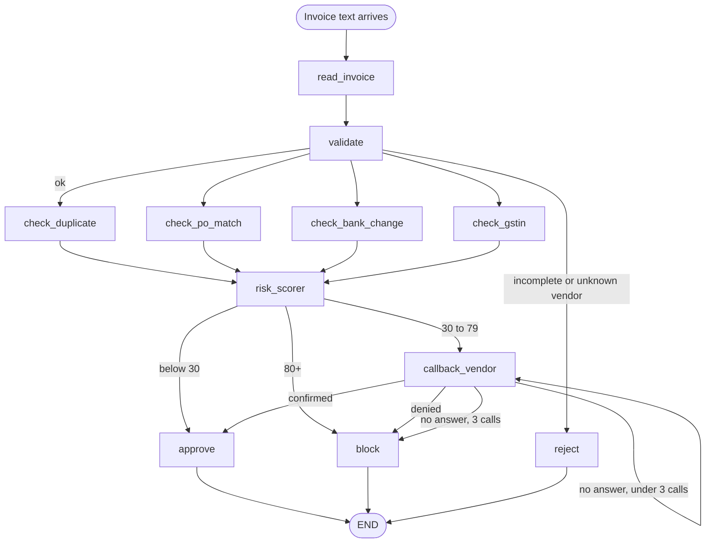
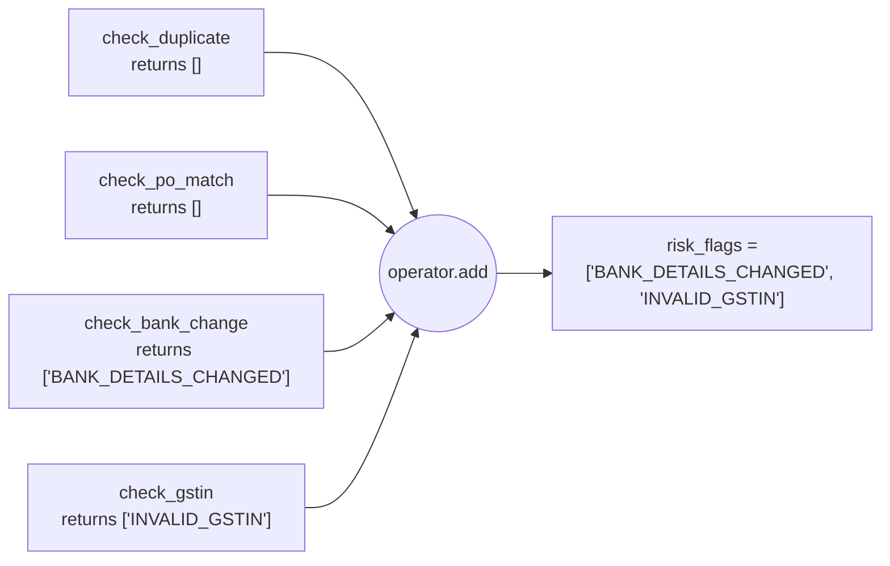
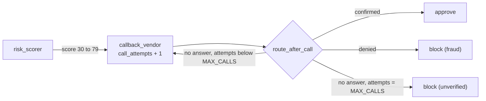
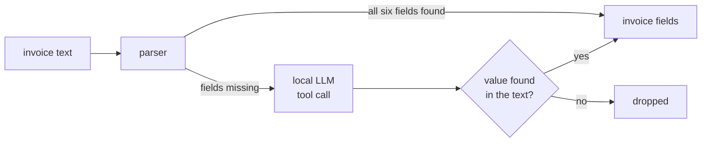

# Building a stateful agent with LangGraph

A beginner's tutorial based on Vendor Payment Guard, a local agent that checks vendor invoices for fraud.

Agentic AI (STAI343), midterm project. The code is in `vendor_payment_guard.ipynb` and runs offline.

## Before you start

You don't need to know LangGraph, but you should be comfortable with basic Python: functions, dictionaries and lists.
Each section covers one idea and shows the actual code from the notebook. References like *(notebook §4)* point to the
matching section of the notebook, so it helps to have it open alongside this.

The parts the assignment asks to focus on are the reducer pattern (section 4), loops and how to stop them running
forever (section 7), tracing the delta (section 8) and diagrams of the agent's behaviour (section 9).

## 1. The problem

Shakti Auto Components is a small factory in Pune that buys steel from Sharma Steel Traders. One morning the accounts
team gets this email:

> Dear team, please find invoice SST/2026/0412 for PO-1001, ₹4,50,000. Note: we have changed our bank.
> Kindly pay to A/c 99887766554.

The PO number is real and the amount is right, but Sharma Steel never sent it. Someone got into their email, or made a
convincing copy of it, and changed the bank account to their own. This kind of invoice fraud is common enough to have a
name, business email compromise, and it has cost Indian companies ₹2 crore (Chennai) and ₹2.35 crore (Pune) in
reported cases.

A careful accountant would check that the invoice hasn't been paid already, that it matches a real purchase order, that
the goods actually arrived, and that the bank account and GST number match what's on record. If anything looked off,
they would phone the supplier on the number they already have, not the one in the email, and only then decide whether
to pay. The agent in this project does the same thing for every invoice.

*Quick check: why does the agent call the number from our records instead of the one on the invoice? Because whoever
sent a fake invoice controls everything written on it, but not our vendor records.*

## 2. Why not just use a chatbot?

A chat model on its own is stateless. It answers each message separately, it can give different answers to the same
question, and it doesn't keep track of what has already happened. That's fine for conversation but not for deciding
whether to release a payment, where you want the same invoice to get the same decision every time, and you want to be
able to explain why.

So instead the agent is built as a state machine: a fixed set of steps (nodes) joined by arrows (edges), with a shared
record (the state) that is passed from step to step. It can remember things like how many times it has phoned a vendor,
run checks in parallel, retry, and keep a log of every step. LangGraph is the Python library that runs it.

## 3. The architecture



Reading it from the top: `read_invoice` turns the text into six fields and `validate` makes sure the invoice can be
checked at all. If it can't, it goes to `reject`. Otherwise four checks run at the same time, each one raising warning
flags if it finds something. `risk_scorer` waits for all four, adds up the points, and the total decides whether the
invoice is approved, blocked, or sent to `callback_vendor`, which can loop back to itself up to three times if the
vendor doesn't answer.

The notebook draws the same graph from the compiled LangGraph object *(notebook §11.1)*:


Building any LangGraph agent comes down to four calls *(notebook §7)*:

```python
builder = StateGraph(PaymentState)            # a graph that carries our state
builder.add_node(validate)                    # register a function as a node (named after the function)
builder.add_edge("read_invoice", "validate")  # connect two nodes
graph = builder.compile()                     # turn it into something you can run
```

## 4. State, deltas and the reducer pattern

### The state

The state is one Python dictionary that every node can read. A good way to picture it is a file folder that moves from
desk to desk in an office: each desk does its one job and adds a note before passing it on. Its shape is declared up
front *(notebook §4)*:

```python
class PaymentState(TypedDict):
    raw_text: str          # the invoice as received
    invoice: dict          # invoice_no, vendor, po_number, amount, gstin, bank_account
    vendor: dict           # our own record of this vendor
    errors: list[str]      # why the invoice can't be checked, if anything

    risk_flags: Annotated[list[str], operator.add]   # appended to, not replaced
    risk_score: int
    call_attempts: int     # loop counter
    vendor_response: str
    decision: str          # APPROVED / BLOCKED / REJECTED
    reason: str

    audit_log: Annotated[list[str], operator.add]    # one line per node
```

### Nodes return deltas

A node never returns the whole state, only the keys it changed. That small dictionary is called the delta. Every check
in this project returns its delta through a small helper:

```python
def report(check_name, flags):
    # the delta every check returns: just 2 keys
    return {"risk_flags": flags, "audit_log": [f"{check_name}: {', '.join(flags) or 'clean'}"]}

def check_bank_change(state):
    changed = state["invoice"]["bank_account"] != state["vendor"]["bank_account"]
    return report("check_bank_change", ["BANK_DETAILS_CHANGED"] if changed else [])
```

LangGraph then merges the delta into the state. How it merges each key depends on that key's reducer.

### Reducers

A plain field like `risk_score: int` has no reducer, so a new value simply replaces the old one. A field declared as
`Annotated[list, operator.add]` uses `operator.add` as its reducer, which for lists means `old + new`: the new items are
appended.

The reason this matters here is that the four checks run in the same step and all of them write `risk_flags`. For
invoice 6 (fake GSTIN and a new bank account) they return four separate lists:



With the reducer, LangGraph joins them and `risk_scorer` sees both flags, scoring 50 + 40 = 90. Without it, LangGraph
would have to pick one of the four values to keep, which it refuses to do. The notebook shows this by building the same
four checks into a graph whose state has a plain `risk_flags: list[str]` *(notebook §9)*:

```
InvalidUpdateError: At key 'risk_flags': Can receive only one value per step. Use an Annotated key to handle multiple values.
```

The general rule: if more than one node can write the same key in the same step, that key needs a reducer.

`audit_log` uses `operator.add` for a different reason. Every node adds a line to it, and appending means none of those
lines are lost, so at the end of a run there's a complete record of what the agent did.

*Quick check: `call_attempts` has no reducer. Why is replacing the right behaviour for it? Only one node writes it, and
it always writes the new total (1, then 2, then 3).*

## 5. Nodes and tools

| Node | What it does |
|---|---|
| `read_invoice` | turns the text into six fields |
| `validate` | checks the fields are present and the vendor is known |
| `check_duplicate`, `check_po_match`, `check_bank_change`, `check_gstin` | the four checks |
| `risk_scorer` | adds up the points for all flags |
| `callback_vendor` | phones the vendor (simulated) and counts the call |
| `approve`, `block`, `reject` | record the final decision and the reason |

The nodes don't hold any company data themselves. When they need to know something they call a tool, which here is just
a small Python function *(notebook §3)*: `find_vendor`, `find_purchase_order`, `find_goods_receipt`, `is_already_paid`,
`is_valid_gstin_format` and `call_vendor`. The last one is simulated: it returns whatever a fixed script says the vendor
answered on that attempt, so every run behaves the same way.

Here's the purchase order check, which calls two tools:

```python
def check_po_match(state):
    invoice = state["invoice"]
    po = find_purchase_order(invoice["po_number"])                     # tool call
    if po is None or po["vendor_id"] != state["vendor"]["vendor_id"]:
        return report("check_po_match", ["NO_MATCHING_PO"])
    flags = []
    if invoice["amount"] > po["amount"]:
        flags.append("AMOUNT_EXCEEDS_PO")
    if find_goods_receipt(invoice["po_number"]) is None:               # tool call
        flags.append("GOODS_NOT_RECEIVED")
    return report("check_po_match", flags)
```

The LLM also uses a tool, in a slightly different way. That's covered in section 10.

## 6. Conditional routing

A normal edge always leads to the same node. A conditional edge calls a router function to decide where to go next.
Routers read the state and return a node name, and they never change the state themselves *(notebook §6)*.

```python
def route_by_score(state):
    if state["risk_score"] < APPROVE_BELOW:     # 30
        return "approve"
    if state["risk_score"] >= BLOCK_FROM:       # 80
        return "block"
    return "callback_vendor"

builder.add_conditional_edges("risk_scorer", route_by_score, ["approve", "callback_vendor", "block"])
```

The agent has three routers. `route_after_validate` returns `"reject"` for a bad invoice, and otherwise returns the list
of all four check names. Returning a list is what makes the four checks start together (a fan-out).
`route_by_score` is the one above. `route_after_call` decides what happens after each phone call, including whether to
call again.

The opposite of the fan-out is the join: `builder.add_edge(CHECKS, "risk_scorer")`. Passing a list as the start of an
edge means the scorer waits until every check in the list has finished and then runs once.

## 7. Loops, and stopping them

### Why the agent needs a loop

Vendors don't always answer the phone. If the agent gave up after one missed call it would block honest suppliers like
Patil Plastics (invoice 3), who answer the second time. So `callback_vendor` is allowed to route back to itself, which
puts a cycle in the graph.



```python
def callback_vendor(state):
    attempt = state.get("call_attempts", 0) + 1
    phone = state["vendor"]["phone"]                     # our number, never the invoice's
    answer = call_vendor(phone, attempt)
    return {"call_attempts": attempt, "vendor_response": answer,
            "audit_log": [f"callback_vendor: call #{attempt} to {phone} -> {answer}"]}

def route_after_call(state):
    if state["vendor_response"] == "confirmed":
        return "approve"
    if state["vendor_response"] == "no_answer" and state["call_attempts"] < MAX_CALLS:
        return "callback_vendor"      # try again
    return "block"
```

The loop only works because of the state. Each time round, `callback_vendor` returns a `call_attempts` that is one
higher, and the router reads it. Without somewhere to store that number there would be no way to count.

### The infinite loop problem

Rao Rubber Works (invoice 5) never answers. If nothing counted the calls, the agent would keep phoning forever and the
program would never finish.

There are two safeguards. The first is the `call_attempts < MAX_CALLS` condition in `route_after_call`, with
`MAX_CALLS = 3`. That's the intended way out: after three unanswered calls the invoice is blocked as unverified.

The second is LangGraph's `recursion_limit`, passed on every run as `config={"recursion_limit": 20}`. LangGraph counts
steps (supersteps) and raises `GraphRecursionError` if a run goes past the limit. A normal run here takes at most 8 steps
(`read_invoice`, `validate`, the four checks as one parallel step, `risk_scorer`, three calls and `block`), so 20 never
gets in the way, but it would stop a loop that a bug had left without an exit.

### Breaking the first safeguard on purpose

The notebook builds a small graph whose router doesn't count calls at all *(notebook §10)*:

```python
def route_after_call_no_guard(state):
    # no MAX_CALLS check
    return "callback_vendor" if state["vendor_response"] == "no_answer" else END
```

Run against Rao with the limit lowered to 6, it calls until LangGraph stops it:

```
callback_vendor: call #1 to +91-90000-10004 -> no_answer
callback_vendor: call #2 to +91-90000-10004 -> no_answer
...
callback_vendor: call #6 to +91-90000-10004 -> no_answer
GraphRecursionError: Recursion limit of 6 reached without hitting a stop condition.
```

So any cycle needs an exit condition stored in the state, and it's worth keeping a recursion limit as well in case that
condition ever breaks.

## 8. Tracing the delta

Tracing the delta means following a run one node at a time and asking what each node changed and what the state looks
like afterwards. `graph.stream(..., stream_mode="updates")` gives you each node's delta as it happens:

```python
for update in graph.stream({"raw_text": invoice_text}, stream_mode="updates", config=RUN_CONFIG):
    for node_name, delta in update.items():
        print(node_name, delta)
```

Here is invoice 5 (Rao Rubber Works: new bank account, vendor never answers). The notebook prints the deltas as a table
*(notebook §11.3)*; the columns on the right show what the state holds after each step.

| # | Node | Delta returned | `risk_flags` after | `risk_score` | `call_attempts` | Next |
|-|-----|----------------|-------|---|---|-------|
| 0 | (input) | `raw_text` | - | - | - | `read_invoice` |
| 1 | `read_invoice` | `invoice: {invoice_no: RRW/0931, …, bank_account: 11223344556}` | - | - | - | `validate` |
| 2 | `validate` | `vendor: {V004 … bank_account: 20456789012 …}`, `errors: []` | - | - | - | all four checks |
| 3 | `check_bank_change` | `risk_flags: ['BANK_DETAILS_CHANGED']` | | | | |
| 4 | `check_duplicate` | `risk_flags: []` | | | | |
| 5 | `check_gstin` | `risk_flags: []` | | | | |
| 6 | `check_po_match` | `risk_flags: []` | `['BANK_DETAILS_CHANGED']` (merged) | - | - | `risk_scorer` |
| 7 | `risk_scorer` | `risk_score: 50` | same | 50 | - | 50 is between 30 and 79, so `callback_vendor` |
| 8 | `callback_vendor` | `call_attempts: 1`, `vendor_response: no_answer` | same | 50 | 1 | 1 < 3, call again |
| 9 | `callback_vendor` | `call_attempts: 2`, `vendor_response: no_answer` | same | 50 | 2 | 2 < 3, call again |
| 10 | `callback_vendor` | `call_attempts: 3`, `vendor_response: no_answer` | same | 50 | 3 | 3 is not < 3, so `block` |
| 11 | `block` | `decision: BLOCKED`, `reason: could not reach vendor after 3 call(s) - unverified` | same | 50 | 3 | END |

Rows 3 to 6 ran in parallel, in a single step. Every row also appended one line to `audit_log`.

Two things are worth noticing. In rows 3 to 6 each check returns its own small list, and the state only holds the merged
list once all four have finished, which is the reducer at work. In rows 8 to 10 `call_attempts` goes from 1 to 3 and the
router reads it each time, which is the loop guard at work. Nothing is ever removed from the state: each delta only adds
to or replaces the keys it names, which is what makes the run easy to audit afterwards.

*Quick check: trace invoice 3 (Patil). The first call gets no answer, so the router loops; the second call is confirmed,
so the invoice goes to `approve` after two calls.*

## 9. The agent's behaviour

The notebook runs all seven test invoices and draws the graph once for each, colouring the path that invoice took
*(notebook §11.2)*. Green means approved, red blocked, orange rejected.


| # | Invoice | Path | Decision |
|-|----------|----------|-----|
| 1 | clean invoice | checks, score 0, approve | approved |
| 2 | already paid | checks, score 100, block | blocked |
| 3 | Patil: new bank, answers on the second call | score 50, call, call again, approve | approved |
| 4 | Gupta: new bank, vendor denies sending it | score 50, call, block | blocked (fraud) |
| 5 | Rao: new bank, never answers | score 50, three calls, block | blocked |
| 6 | fake GSTIN and new bank | score 90, block | blocked |
| 7 | PO number and amount missing | validate, reject | rejected |

The notebook also keeps an `EXPECTED` dictionary with the decision each invoice should get, and the results table
includes an `as expected` column *(notebook §8)*. All seven come out `True`.

## 10. Using the local LLM to read messy invoices

The test invoices use a simple `Label: value` layout that a short parser can read. Real invoices often arrive as emails
instead:

> Please find our bill no. SST/2026/0415 … against your order PO-1001. Total payable: Rs. 4,50,000/- …
> Kindly remit to our HDFC current a/c no. 50100234567.

The parser finds nothing in that. A local model (`qwen3:4b-instruct`, running through Ollama) can read it, using tool
calling. We write an ordinary Python function, `submit_invoice_fields(invoice_no, vendor, po_number, amount, gstin,
bank_account)`, and Ollama turns its signature and docstring into a tool description. The model replies with a call to
that tool, including the arguments it filled in, and our code runs the function with them:

```python
response = ollama.chat(model=LLM_MODEL, messages=[...], tools=[submit_invoice_fields],
                       options={"temperature": 0})
for call in response.message.tool_calls or []:
    if call.function.name == "submit_invoice_fields":
        return submit_invoice_fields(**call.function.arguments)
```

When we tried the model on the seven test invoices, it got most fields right but sometimes copied a value wrongly:
`PO-1001` came back as `PO-10_001`, and once a bank account had a digit changed. For a payment system that's a real
risk, so `read_invoice` is set up in layers:



The parser always goes first, and the LLM is only asked about fields the parser couldn't find. Any value the LLM returns
is kept only if it appears word for word in the invoice text. If Ollama isn't running, the node uses the parser result
on its own. The LLM never decides whether an invoice is approved or blocked; that's left to the rules.

With this in place, the email above is rejected when only the parser is used and approved once the LLM is switched on,
using exactly the same checks *(notebook §12)*.

One thing that came up while building it: when the tool description gave `PO-1001` as an example of a PO number, the
model kept returning `PO-10_01` for the email. The verification step dropped the value, so nothing went wrong, and
removing the example from the description fixed it. Small changes in wording affect a model's output, which is the main
reason to check what it returns.

## 11. Edge cases

| Situation | What the agent does | Where |
|---|---|---|
| invoice already paid | `DUPLICATE_INVOICE` (100), blocked | `check_duplicate` |
| bank account differs from our records | `BANK_DETAILS_CHANGED` (50), vendor is called | `check_bank_change` |
| vendor says they never sent it | blocked as likely fraud | `route_after_call`, `block` |
| vendor never answers | blocked after three calls | loop guard |
| GSTIN in the wrong format | `INVALID_GSTIN` (40) | `check_gstin` |
| valid GSTIN belonging to another company | `GSTIN_MISMATCH` (40) | `check_gstin` |
| no PO, or a PO for a different vendor | `NO_MATCHING_PO` (40) | `check_po_match` |
| amount above the PO | `AMOUNT_EXCEEDS_PO` (30) | `check_po_match` |
| goods not received yet | `GOODS_NOT_RECEIVED` (30) | `check_po_match` |
| several problems at once | points add up, e.g. 50 + 40 = 90, blocked | `risk_scorer` |
| missing fields | rejected, listing what's missing | `validate`, `reject` |
| vendor not in our records | rejected | `validate`, `reject` |
| amount written as `4,50,000` or `Rs. 4,50,000/-` | converted to `450000` | `to_rupees` |
| LLM copies a value wrongly | value not found in the text, so it's dropped | `read_invoice` |
| Ollama not running | parser result used on its own | `read_invoice` |
| a bug leaves the loop without an exit | `GraphRecursionError` after 20 steps | `recursion_limit` |
| two nodes write the same key in parallel | needs a reducer, otherwise `InvalidUpdateError` | `PaymentState` |

Some things are simplified for the prototype: the phone calls are simulated, the company data lives in Python
dictionaries, a vendor confirming a new bank account doesn't update their record, and an invoice split into smaller
ones to stay under a limit wouldn't be noticed.

## 12. Things to try

All the rules are constants at the top of the notebook *(notebook §1)*, so you can change one, run everything again,
and see how the routes change.

1. Set `RISK_POINTS["BANK_DETAILS_CHANGED"] = 80`. Invoices 3, 4 and 5 should now skip the phone call and be blocked
   straight away.
2. Set `MAX_CALLS = 1`. Invoice 3 should now be blocked, because Patil only answers on the second call.
3. Add a fifth check that flags any invoice over ₹3,00,000:

   ```python
   def check_high_value(state):
       flags = ["HIGH_VALUE"] if state["invoice"]["amount"] > 300000 else []
       return report("check_high_value", flags)
   ```

   Add `"HIGH_VALUE": 30` to `RISK_POINTS`, add `"check_high_value"` to `CHECKS`, add the function to the list of nodes
   in §7, and give it a position in `POSITIONS` so the drawing still works. Invoice 1 (₹4,50,000) should now score 30
   and go to `callback_vendor`. Sharma Steel isn't in `CALLBACK_SCRIPT`, so nobody answers and it ends up blocked after
   three calls; adding `"+91-90000-10001": ["confirmed"]` to the script gets it approved. The fan-out and join pick up
   the new check automatically because they use the `CHECKS` list, and the reducer merges its flag with the others.

## 13. Glossary

| Term | Meaning |
|---|---|
| agent | a program that works towards a goal in steps, using tools and making decisions along the way |
| state machine | a fixed set of steps with defined transitions between them |
| LangGraph | a Python library for building agents as graphs of nodes and edges with shared state |
| state | the dictionary passed through the graph (`PaymentState`) |
| node | a function that reads the state and returns a delta |
| delta | the dictionary a node returns, containing only the keys it changed |
| reducer | the rule for merging a delta into the state; replace by default, append with `operator.add` |
| edge | a connection from one node to the next |
| conditional edge, router | an edge whose destination is chosen at run time by a router function |
| fan-out, join | starting several nodes in parallel, and waiting for all of them before continuing |
| superstep | one round of execution; nodes in the same superstep run in parallel and their deltas are merged at the end |
| cycle, loop | an edge leading back to an earlier node (here, `callback_vendor` to itself) |
| `recursion_limit` | the maximum number of supersteps in one run; going past it raises `GraphRecursionError` |
| tool, function calling | the agent, or the LLM, calling a function to look something up or act |
| Ollama | software for running language models on your own computer |
| deterministic | the same input always gives the same output |
| GSTIN | the 15-character Indian GST registration number |
| PO, GRN | purchase order, and goods receipt note (proof of delivery) |
| BEC | business email compromise: fraud using a hacked or imitated business email account |
